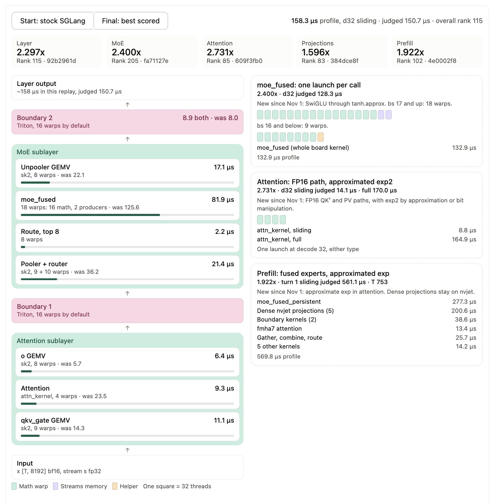

# Open Kernel Challenge

This repository contains my five final scored kernels for Muse Spark Open.
Each Python file builds its CUDA kernels for one NVIDIA H200.
The kernel track closed on 5 November 2026.

## Results

Speed-up compares each kernel with stock SGLang.
The table lists my best scored run for each board.
Ranks are the recorded provisional values from 5 November 2026.
The organizers determine the final ranks after their test runs.

| Board | Kernel file | Speed-up | Provisional rank | Job ID |
|---|---|---|---|---|
| Decode layer | [muse_decode_layer.py](kernels/muse_decode_layer.py) | 2.297× | 115 of 1,299 | `92b2961dcb7d4888` |
| Attention decode | [muse_attention_decode.py](kernels/muse_attention_decode.py) | 2.731× | 85 of 1,379 | `609f3fb0074244eb` |
| MoE, W4A16 | [muse_moe_w4a16.py](kernels/muse_moe_w4a16.py) | 2.400× | 205 of 1,425 | `fa71127eb0e844da` |
| BF16 projections | [muse_bf16_proj.py](kernels/muse_bf16_proj.py) | 1.596× | 83 of 1,746 | `384dce8f584741df` |
| Prefill layer | [muse_prefill_layer.py](kernels/muse_prefill_layer.py) | 1.922× | 102 of 898 | `4e0002f8678540f2` |

The recorded overall rank is **115 of 2,014**.
The overall rank follows the decode layer board.
The files retain the final scored code, technical comments, and experiment references.

## Best scored profile

The image shows the saved GPU profiles.
For decode batch 32 with sliding attention, the kernel times total 158.3 µs.
GPU busy time is 153.2 µs because kernels overlap.
The benchmark mean is 150.7 µs.
The image uses benchmark means for the times marked “judged”.

The source files give these corrections to the image's warp labels:

| Component | Correct warp count |
|---|---|
| Decode layer boundaries at batch 32 | 32 warps for each boundary kernel. |
| Fused pooler and router | 12 warps per thread block. |
| Small MoE builds | The batch-8 build uses 10 warps. Batches 5–7 can use this build after self-tests. Other small builds use 9 warps. |

## My changes

Source comments identify my changes with `ethduke` or `Change by ethduke`.
The main changes are:

| Kernel | Changes |
|---|---|
| Decode layer | The build uses the attention board flags. MID serves 5–8 tokens, and narrow sk2 serves one token. Projection size selection extends after self-tests. The batch-16 and batch-32 graft paths stay on. Attention uses FP16 QKᵀ, and SwiGLU uses fast tanh. Programmatic dependent launch links rq GEMMs, and unfused sk2 kernels read activations directly. |
| Attention decode | Query length 8 uses FP16 QKᵀ and approximate exp2. The full-layer verify path uses the base attention kernels. |
| MoE | SwiGLU uses fast tanh. After self-tests, the batch-8 build also serves 5–7 tokens. |
| BF16 projections | prepare() compares each kernel choice with FP64 results on normal inputs and inputs at 30 times the normal scale. It selects the default choice if a test fails. |
| Prefill layer | Attention uses approximate exp2. kernel_fn() sets the primary CUDA context on new threads. The lazy-rescale threshold increases from 0.75 to 1.5 in log2 units. |

Two parallel agents supplied the final decode layer changes.
[METHOD.md](METHOD.md) describes the fork-and-flush rounds and their measured results.

## Accuracy and measurement

The kernels use approximate math and FP16 accumulation in some attention paths.
The kernel rules of 3 November 2026 permit these methods.
All five scored runs passed the judge's correctness tests.
The kernels target the challenge shapes and the NVIDIA H200.
Some sizes use fallback paths.

Board scores vary between runs.
Paired checks compare each candidate with its parent on the same inputs.
A/A checks and identical kernel builds measure timing noise.
Two separate paired checks confirmed the final decode layer changes.

## Sources and license

These files contain third-party kernels, which provide most of the performance gain.
[NOTICE](NOTICE) identifies the source repositories, authors, components, and licenses.
The source files retain their attribution comments.

The repository uses [Apache License 2.0](LICENSE).
[NOTICE](NOTICE) and the source files also contain the applicable MIT and BSD-3-Clause notices.
